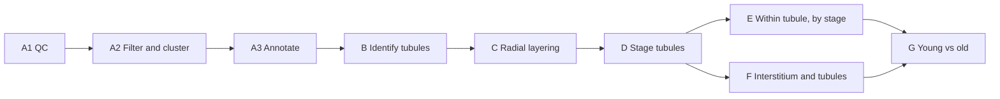

# Analysis plan

Dated 2026-11-02. Each of the collaborator's 16 mouse testis sections is analysed on its own: QC,
clustering and cell-type annotation, then tubules identified, layered and staged. That lets
cell-type proportions, gene and signalling dynamics, and the interstitium be compared by stage,
and finally between young and old animals.

`NOTES.md` tracks where the runs stand; this file is what the analysis is for and in what order.

## At a glance

Phases A to F run per section. Layering (C) doubles as a check on A3 and B: if germ cells do
not come out in the expected order, the annotation or the tubule boundaries are wrong. Only G
pools sections.

## Where it stands

13 of 16 sections are clustered; none are annotated yet. Status is from `NOTES.md` of
2026-10-30, when the c1r1 and a1r0 jobs were still pending on OSCER.

| Sections | Segmentation | Steps 1a-1b (store + table) | Step 2 (clustering) | Step 3 (annotation) |
|---|---|---|---|---|
| 2ar0, 2ar1, 2br0, 2br1, a1r1, b2r0, b2r1, b2r2, c1r0, c1r2, d2r0, d2r1, d2r2 | 3D cellpose | Done | Done | Not run |
| c1r1 | 3D cellpose, cropped raster (offset -270, -293) | 1a done, 1b queued | Queued after 1b | Not run |
| a1r0-upper, a1r0-lower | 3D cellpose, one raster for both sections (offset -245, -290) | Split queued | Not started | Not run |

b2r0 is the pilot: the analysis is settled on it first, then the finished notebook is rendered
across all 16 with `render_sample`.

## Phase A1 — Segmentation and data QC

Each section gets a QC pass before any thresholds are set, so a bad region is caught here
rather than in a figure.

- Cells per section; transcripts, genes and volume per cell
- Share of transcripts assigned to a cell; blank codewords against real genes
- Which z-plane each boundary came from (`obs["z_plane"]`), and cells with no polygon
  (`has_boundary`)
- The same metrics drawn on tissue, to catch FOV seams, edge effects and damaged areas

The report already has a QC section; the on-tissue QC maps are new.

## Phase A2 — Filtering and clustering

Step 2 (`bin/cluster_spatialdata_gpu.py`) clusters each section on the GPU with
rapids-singlecell, using one fixed recipe, and writes a Leiden sweep rather than a single answer.

| Stage | What the step does |
|---|---|
| Filter, low | Drop cells under 20 transcripts (`--min_counts`) |
| Filter, high | Drop the top quantile of transcript counts, for doublets and merged cells (`--max_counts_quantile`); off by default, and taken before the low cut |
| Genes | All panel genes kept: no highly-variable selection and no gene filter, since the 491-gene panel is already curated |
| Normalize | Total counts scaled to the section's median cell total, then log1p |
| Scale | Unit variance, not centred, clipped at 10 |
| PCA | 30 components |
| Neighbors | Cosine distance, rapids default k = 15 |
| UMAP | On that graph |
| Leiden | Resolutions 0.1 to 2.0 in steps of 0.1; random seed 0 throughout |

Each resolution leaves two columns. `_v0` is Leiden's own labelling; `_v1` renumbers clusters
1..k by size, so cluster 1 is the largest. **v1 is what every call and figure names a cluster
by.** The report adds a render-only `v2`, the cluster's position down the dendrogram, so
neighbouring numbers are transcriptionally similar; figures read `v1 (v2)`.

Normalizing to each section's own median makes log-normalized values a per-section scale.
Anything compared across sections starts from counts.

Step 4 (`bin/create_centroids.py`) then sums counts and CP10K per cluster at every resolution.
Sums pool, so any union of clusters is the sum of its rows, and `log1p(X / n_cells)` is
comparable to the `ln(mean + 1)` reference centroids.

Per section, still to do:

- Choose the resolution. The report reads one (`RESOLUTION`, 1.0 today); choose by stability
  across the sweep and by how cleanly markers separate.
- Add top marker genes per cluster; the report does not show them yet.
- Decide whether filter thresholds are fixed for all sections or set per section.

## Phase A3 — Cell-type annotation

Every cell is correlated against a reference, and each cluster is then named by a person from
the mix of its cells' calls. Step 3 makes no cluster-level call itself.

1. **Per-cell correlation (step 3, `bin/annotate_celltypes.py`).** Spearman correlation of each
   cell's raw counts against every reference cell type, over the genes the panel and reference
   share. Genes match case-insensitively, so mouse `Acta2` finds human `ACTA2`; the matched genes
   are written to `<sample>.gene_overlap.tsv`.
2. **Standardize within each cell.** A cell's correlation to every type rises with the genes it
   captured, so correlations are z-scored per cell. This cannot change a cell's top type; it
   makes cells comparable with each other.
3. **Per-cell call.** `cell_type_per_cell` is the type with the highest correlation; every
   type's value is kept as `corr_<type>`.
4. **Cluster composition (report).** Each cluster's share of cells per called type.
5. **Cluster call (by hand).** A cluster is named when one type takes at least 70% of its cells
   (`PURITY_THRESHOLD`). Below that it is called Ambiguous, and gets its own slide laying out
   the evidence.

| Reference | Species | Cell types | Values | Fit for this plan |
|---|---|---|---|---|
| Green et al. 2018, from the collaborator (`green_mouse_testis_centroids.csv.gz`) | Mouse | 32: 7 somatic, 9 Sertoli subtypes, 16 germ-cell types | Unconfirmed | Resolves the germ-cell stages that layering and staging need |
| Shami et al. (`shami_human_testis_centroids.csv.gz`, current default) | Human | 11 major types | ln(mean + 1) | Too coarse for staging; useful as a cross-check |

**Recommendation:** annotate with the Green mouse reference, once the collaborator confirms how
its values were computed. Their own script uses Pearson on log2 counts per 1,000; ours is
Spearman, which uses only ranks, so the scale matters less but still needs confirming.

Calls must mean the same thing in every section for Phase G. One fixed reference does most of
that; the hand-made cluster calls follow one written rulebook (marker genes per type, the 70%
threshold).

## Phase B — Identify tubules

Every cell gets a `tubule_id` and a `compartment` (tubule, boundary or interstitium), and every
tubule a polygon.

- **From cells:** peritubular myoid cells (Acta2, Myh11) trace each boundary; germ and Sertoli
  cells fill the inside. Connected tubular cells on a spatial graph, closed with a concave hull.
- **From the image:** segment tubules and lumens from the mosaic (DAPI, polyT or a boundary
  stain).
- Likely a combination: cells for the boundary, the image to check it.
- QC per tubule: area, circularity, cell count. Flag tubules cut obliquely, since they distort
  radial position and staging.

Where the polygons live is open: the store is written once by design, so a tubule shapes element
goes beside the table (GeoParquet, say) or needs an exception. Per-cell columns fit in the table.

Prototype in a notebook on b2r0; promote to a pipeline step once the method settles.

## Phase C — Radial layering

Each cell in a tubule gets a radial position: 0 at the basement membrane, 1 at the lumen.

- Expected order, outside in: spermatogonia and Sertoli nuclei, spermatocytes, round
  spermatids, elongating spermatids.
- Checks Phases A3 and B together; a wrong order points at one of them.
- Gene expression along the radial axis, within each cell type.

## Phase D — Stage the tubules

Each tubule cross-section sits at one stage of the epithelial cycle (I-XII in mouse), set by
which germ cells occur together.

- **Rule-based:** germ-cell associations and stage markers (e.g. Stra8 in stages VII-VIII).
- **Unsupervised:** a composition or pseudobulk profile per tubule, ordered around the cycle;
  tubule profiles often form a ring.
- Realistic target: stage groups (I-III, IV-VI, VII-VIII, IX-XII) rather than all twelve.
- Ask the collaborator whether these sections have been staged before; that is a ready validation set.

## Phase E — Within the tubule, by stage

- Cell-type proportions by stage
- Gene expression across the cycle per cell type, as pseudobulk per tubule ordered by stage
- Sertoli-germ cell signalling by stage, from ligand-receptor pairs

Only pairs on the 491-gene panel can be tested; listing which ones are is a cheap early step.

## Phase F — Extratubular cells and the tubule

- Interstitial types: Leydig, macrophages (peritubular vs interstitial), endothelial, peritubular
  myoid
- Neighbourhood enrichment, and each cell's distance to the nearest tubule
- Whether the interstitium beside a tubule changes with that tubule's stage
- Ligand-receptor signalling across the basement membrane

## Phase G — Young vs old

- Distribution of tubules across stages
- Composition within each stage
- Tubule size
- Interstitium: Leydig and macrophage numbers and position
- Expression by stage and cell type

The unit of replication is the **animal**, not the section or the tubule: pseudobulk per animal,
or mixed models with animal as a random effect. Sections from one animal are not independent.

## Decisions and open questions

- [ ] Which sections are young and which old, and how many animals in each? (Do the a1, b2, c1,
      d2, 2a, 2b prefixes mark animals?)
- [ ] Reference: confirm with the collaborator how the Green centroids were computed, then annotate with it
- [ ] Resolution: one for all sections, or chosen per section?
- [ ] Filter thresholds: fixed, or set per section?
- [ ] Which image channels exist for tubule segmentation?
- [ ] Where tubule polygons are stored, given the store is write-once
- [ ] Has the collaborator staged any of these sections?
- [ ] Which ligand-receptor pairs the panel covers
