# MERFISH testis — per-section demo
Brent Biddy
2026-11-05

- [B1. Load the section](#b1-load-the-section)
- [B2. The tissue image](#b2-the-tissue-image)
- [Phase C — Dimension reduction](#phase-c--dimension-reduction)
  - [C1. Filter cells](#c1-filter-cells)
  - [C2. Normalize](#c2-normalize)
  - [C3. Scale](#c3-scale)
  - [C4. PCA](#c4-pca)
  - [C5. Neighbour graph](#c5-neighbour-graph)
  - [C6. UMAP](#c6-umap)
- [Phase D — Cell-type annotation](#phase-d--cell-type-annotation)
  - [D0. The reference](#d0-the-reference)
  - [D3. Per-cell correlation](#d3-per-cell-correlation)
  - [D4. Standardize within each cell](#d4-standardize-within-each-cell)
  - [D5. Per-cell call](#d5-per-cell-call)
  - [D6. Germ-cell subtypes](#d6-germ-cell-subtypes)
- [Phase E — Tubules](#phase-e--tubules)
  - [E1. Load the outlines](#e1-load-the-outlines)
  - [E2. The tubules on the section](#e2-the-tubules-on-the-section)
  - [E3. Tubules at full resolution](#e3-tubules-at-full-resolution)
  - [E4. Which tubule each cell is in](#e4-which-tubule-each-cell-is-in)
- [Phase G — Tubule stage](#phase-g--tubule-stage)
  - [G1. The stage of each tubule](#g1-the-stage-of-each-tubule)
  - [G2. The tubules by stage](#g2-the-tubules-by-stage)
  - [G3. Stage on the UMAP and the
    tissue](#g3-stage-on-the-umap-and-the-tissue)
- [Phase H — Composition by stage](#phase-h--composition-by-stage)
  - [H1. Cell types in a tubule, by
    stage](#h1-cell-types-in-a-tubule-by-stage)
  - [H2. One tubule per stage at full
    resolution](#h2-one-tubule-per-stage-at-full-resolution)

<details>
<summary>Code</summary>

``` python
import os
from pathlib import Path

import anndata as ad
import matplotlib.colors as mcolors
import matplotlib.patheffects as pe
import matplotlib.pyplot as plt
import scanpy as sc
import spatialdata as sd
import numpy as np
import pandas as pd
from matplotlib.collections import PolyCollection
from scipy.stats import kruskal, rankdata
from shapely.affinity import affine_transform
from shapely.geometry import Polygon
from spatialdata.transformations import get_transformation

# Cells under this many transcripts are dropped before dimension reduction (C1).
LOW_COUNT_CUT = 20

# Phase D: the reference's cell types, germ first, and the colours the figures draw them in.
GERM = ["SPG", "Scytes", "STids", "Elongating"]
SOMATIC = ["Sertoli", "Leydig", "Myoid", "Endothelial", "Macrophage", "InnateLymph", "Unknown"]
CELL_TYPES = GERM + SOMATIC
# Listed from the outside of a tubule in, which is the order the legends read. Leydig, Endothelial,
# Macrophage and InnateLymph are between tubules, Myoid wrap the wall and Sertoli sit on it, then
# the germ cells run SPG to Elongating towards the lumen. Unknown is last.
TYPE_COLORS = {
    "Leydig": "#000000", "Endothelial": "#17becf", "Macrophage": "#8c564b", "InnateLymph": "#bcbd22",
    "Myoid": "#e377c2", "Sertoli": "#9467bd",
    "SPG": "#1f77b4", "Scytes": "#2ca02c", "STids": "#ff7f0e", "Elongating": "#d62728",
    "Unknown": "#7f7f7f",
}
GROUP_COLORS = {"germ": "#d98c1f", "somatic": "#4a7fb5"}

# Phase E: how Alex Vargo flagged each tubule, and the colour its outline is drawn in. A tubule
# is "good" for cells when his cell-to-tubule map can be trusted for it, and a "circle" when its
# outline is round enough for a radial profile.
TUBULE_FLAGS = {
    "good circle": "#2ca02c", "good cells, not circular": "#ff7f0e",
    "not good cells": "#d62728", "no metadata": "#e377c2",
}
TUBULE_NAVY = "#10105a"

# Phase G: the four stage groups of his computational staging, in order, and the colours they are
# drawn in. Cells are coloured by the stage of the tubule they are in.
STAGES = [1, 2, 3, 4]
STAGE_COLORS = {1: "#56B4E9", 2: "#009E73", 3: "#F0E442", 4: "#D55E00"}
STAGE_CELL_COLORS = {**{f"stage {s}": c for s, c in STAGE_COLORS.items()},
                     "unstaged tubule": "#c8c8c8", "outside tubules": "#e6e6e6"}

# Phase D6: the twelve germ-cell types, coloured along one ramp so neighbours look alike.
GC_TYPES = [f"GC{i}" for i in range(1, 13)]
GC_COLORS = {gc: mcolors.to_hex(plt.cm.turbo(0.05 + 0.9 * i / 11)) for i, gc in enumerate(GC_TYPES)}
GC_COLORS["not germ"] = "#d9d9d9"

# The repository root, where the cached reference lives. A render outside the
# repository sets MERFISH_REPO.
_start = Path(os.environ["MERFISH_REPO"]) if "MERFISH_REPO" in os.environ else Path.cwd()
REPO = next(p for p in [_start, *_start.parents] if (p / "PLAN.md").exists())
REFERENCE_DIR = REPO / "results/section_analysis/reference"

# What the workflow staged beside the notebook, told apart by file name suffix. The trailing
# comma raises unless exactly one matches.
(TABLE,) = Path(".").glob("*.create_spatialdata_cellpose.h5ad")
(STORE,) = Path(".").glob("*.create_spatialdata_cellpose.zarr")
# Phase E: Alex Vargo's tubule outlines, one <id>.npz per tubule in a directory, and the table of
# his flags for them. A section's metadata file may be the "-staged" one.
(TUBULE_BOUNDS,) = Path(".").glob("*tube-bounds")
(TUBULE_META,) = Path(".").glob("*tubule-metadata*.csv")
# Each cell's tubule, one entry per cell of the full table in the table's order, and his staging
# of the tubules, one table for every section.
(TUBULE_MAP,) = Path(".").glob("*cell-to-tubule-map-goodcells.npz")
(TUBULE_ORDER,) = Path(".").glob("*tubule_order*.csv")
```

</details>

<details>
<summary>Code</summary>

``` python
# Plotting only: every function here takes already-computed data and draws a figure.
# No AnnData indexing, aggregation or column derivation happens in this cell.


def row_major(handles, ncol):
    """Reorder legend handles so they read left to right, then down. Matplotlib fills by column."""
    n_rows = -(-len(handles) // ncol)
    blank = plt.Line2D([], [], ls="", marker="", label="")
    rows = [handles[r * ncol:(r + 1) * ncol] for r in range(n_rows)]
    rows = [row + [blank] * (ncol - len(row)) for row in rows]
    return [rows[r][c] for c in range(ncol) for r in range(n_rows)]


def plot_calls(umap, xy, calls, colors, sample, what, last=(), image=None, legend_cols=6, umap_labels=None):
    """D5: a per-cell label on the UMAP and on the tissue, legend in one row beneath.

    Labels in `last` are drawn on top. `image` is (array, extent, clip): a stain image, the
    extent it covers in tissue micrometres and its display range. It gets its own panel between
    the UMAP and the tissue, drawn over the same window, so the two tissue panels line up.
    `legend_cols` is how many legend entries go in a row. `umap_labels` maps a name to the (x, y)
    on the UMAP where to write it.
    """
    calls = np.asarray(calls)
    on_top = np.isin(calls, list(last))
    order = np.r_[np.random.default_rng(0).permutation(np.flatnonzero(~on_top)), np.flatnonzero(on_top)]
    point_colors = np.array([colors[k] for k in calls])

    n_panels = 2 if image is None else 3
    fig, axes = plt.subplots(1, n_panels, figsize=(6.6 * n_panels - 0.2, 6.6), constrained_layout=True)
    axes[0].scatter(umap[order, 0], umap[order, 1], c=point_colors[order], s=0.3, linewidths=0, rasterized=True)
    axes[0].set(title=f"{sample}: {what} on UMAP", xticks=[], yticks=[])
    for name, (x, y) in (umap_labels or {}).items():
        axes[0].text(x, y, name, ha="center", va="center", fontsize=9, fontweight="bold", color="k",
                     path_effects=[pe.withStroke(linewidth=2.5, foreground="white")])
    tissue = axes[-1]
    tissue.scatter(xy[order, 0], xy[order, 1], c=point_colors[order], s=0.5, linewidths=0, rasterized=True)
    tissue.set(title=f"{sample}: {what} on tissue", xlabel="x (µm)", ylabel="y (µm)")
    window = (xy[:, 0].min(), xy[:, 0].max(), xy[:, 1].max(), xy[:, 1].min())   # x0, x1, y1, y0: y runs down
    if image is not None:
        array, extent, (lo, hi) = image
        axes[1].imshow(array, cmap="gray", vmin=lo, vmax=hi, extent=extent)
        axes[1].set(title=f"{sample}: DAPI", xlabel="x (µm)", ylabel="y (µm)")
    for ax in axes[1:]:
        ax.set_aspect("equal")
        ax.set(xlim=window[:2], ylim=window[2:])
    present = [(label, color) for label, color in colors.items() if (calls == label).any()]
    handles = [plt.Line2D([], [], marker="o", ls="", color=color, ms=6, label=f"{label} ({(calls == label).sum():,})")
               for label, color in present]
    n_cols = min(len(handles), legend_cols)
    fig.legend(handles=row_major(handles, n_cols), loc="outside lower center", ncol=n_cols, frameon=False, fontsize=8)
    return fig


def draw_tubules(ax, polygons, colors=None, lw=1.1, halo=True):
    """Tubule outlines on an axes in micrometres. `colors` maps a tubule id to a colour; the rest are navy."""
    effects = [pe.withStroke(linewidth=lw + 1.5, foreground="white")] if halo else []
    for tubule_id, polygon in polygons.items():
        x, y = polygon.exterior.xy
        ax.plot(x, y, color=(colors or {}).get(tubule_id, TUBULE_NAVY), lw=lw, path_effects=effects)


def legend_under(ax, handles, ncol, gap=-0.1):
    """A legend under an axes, reading left to right, then down."""
    n_cols = min(ncol, len(handles))
    ax.legend(handles=row_major(handles, n_cols), loc="upper center", bbox_to_anchor=(0.5, gap), ncol=n_cols,
              frameon=False, fontsize=8, columnspacing=1.0, handletextpad=0.3)


def dot_handles(colors, names, ms=6):
    return [plt.Line2D([], [], marker="o", ls="", color=colors[n], ms=ms, label=n) for n in names]


def plot_tubule_overview(image, polygons, flag_colors, flag_counts, xy, major_points, gc_points, gc_order,
                         major_present, gc_present, sample):
    """E2: DAPI with the outlines by flag, then the per-cell type and the germ-cell type with navy outlines."""
    array, extent, (lo, hi) = image
    window = dict(xlim=(xy[:, 0].min(), xy[:, 0].max()), ylim=(xy[:, 1].max(), xy[:, 1].min()))
    fig, axes = plt.subplots(1, 3, figsize=(25, 7.8), constrained_layout=True)
    axes[0].imshow(array, cmap="gray", vmin=lo, vmax=hi, extent=extent)
    draw_tubules(axes[0], polygons, flag_colors, lw=0.9, halo=False)    # no halo on the dark image
    axes[0].set(title=f"{sample}: DAPI, tubules by flag")
    axes[1].scatter(xy[:, 0], xy[:, 1], c=major_points, s=0.5, linewidths=0, rasterized=True)
    axes[1].set(title="per-cell type")
    axes[2].scatter(xy[gc_order, 0], xy[gc_order, 1], c=gc_points[gc_order], s=0.5, linewidths=0, rasterized=True)
    axes[2].set(title="germ-cell type")
    for ax in axes[1:]:
        draw_tubules(ax, polygons)
    for ax in axes:
        ax.set(xlabel="x (µm)", ylabel="y (µm)", **window)
        ax.set_aspect("equal")
    legend_under(axes[0], [plt.Line2D([], [], color=c, lw=2, label=f"{k} ({flag_counts[k]})")
                           for k, c in TUBULE_FLAGS.items() if flag_counts[k]], 2)
    legend_under(axes[1], dot_handles(TYPE_COLORS, [t for t in TYPE_COLORS if t in major_present]), 4)
    legend_under(axes[2], dot_handles(GC_COLORS, [g for g in GC_COLORS if g in gc_present]), 5)
    return fig


def plot_tubule_crop(channels, extent, outline, outline_color, cell_polygons, major_colors, gc_colors,
                     major_present, gc_present, title, width=24.0):
    """E3: one tubule at full resolution: DAPI, Cellbound3, then the cells filled by type and by germ-cell type, over DAPI.

    The figure's height follows the crop's shape, so a thin strip does not leave empty space around it.
    """
    ex0, ex1, ey1, ey0 = extent
    panel_width = width / 4 * 0.93
    height = np.clip(panel_width * abs(ey1 - ey0) / abs(ex1 - ex0) + 1.9, 3.4, 8.5)
    fig, axes = plt.subplots(1, 4, figsize=(width, height), constrained_layout=True)
    clip = {name: (np.percentile(a, 1), np.percentile(a, 99.7)) for name, a in channels.items()}
    for ax, name in zip(axes[:2], channels):
        ax.imshow(channels[name], cmap="gray", extent=extent, vmin=clip[name][0], vmax=clip[name][1])
        ax.set_title(name)
    for ax, colors, name in [(axes[2], major_colors, "cells by type, over DAPI"), (axes[3], gc_colors, "germ cells by type, over DAPI")]:
        ax.imshow(channels["DAPI"], cmap="gray", extent=extent, vmin=clip["DAPI"][0], vmax=clip["DAPI"][1])
        ax.add_collection(PolyCollection(cell_polygons, facecolors=colors, edgecolors="k", linewidths=0.2, alpha=0.5))
        ax.set_title(name)
    for ax in axes:
        ax.plot(*outline.exterior.xy, color=outline_color, lw=1.8)
        ax.set(xlim=(ex0, ex1), ylim=(ey1, ey0))
        ax.set_aspect("equal")
        ax.set_axis_off()
    legend_under(axes[2], dot_handles(TYPE_COLORS, [t for t in TYPE_COLORS if t in major_present]), 5, gap=0.0)
    legend_under(axes[3], dot_handles(GC_COLORS, [g for g in GC_COLORS if g in gc_present]), 5, gap=0.0)
    fig.suptitle(title, fontsize=13)
    return fig


def draw_staged_tubules(ax, polygons, colors, staged, halo):
    """Outlines coloured by stage: staged tubules thick, with a halo if asked, the rest thin and grey."""
    for tubule_id, polygon in polygons.items():
        is_staged = tubule_id in staged
        effects = [pe.withStroke(linewidth=3.6, foreground="white")] if halo and is_staged else []
        ax.plot(*polygon.exterior.xy, color=colors[tubule_id] if is_staged else "#8a8a8a",
                lw=1.8 if is_staged else 0.7, zorder=3 if is_staged else 2, path_effects=effects)


def plot_stage_outlines(image, polygons, stage_colors, staged, xy, gc_points, gc_order, stage_counts, n_unstaged, sample):
    """G2: DAPI and the germ-cell type calls, each with the tubule outlines coloured by stage."""
    array, extent, (lo, hi) = image
    window = dict(xlim=(xy[:, 0].min(), xy[:, 0].max()), ylim=(xy[:, 1].max(), xy[:, 1].min()))
    fig, axes = plt.subplots(1, 2, figsize=(20, 8.6), constrained_layout=True)
    axes[0].imshow(array, cmap="gray", vmin=lo, vmax=hi, extent=extent)
    draw_staged_tubules(axes[0], polygons, stage_colors, staged, halo=False)
    axes[0].set(title=f"{sample}: DAPI, tubules by stage")
    axes[1].scatter(xy[gc_order, 0], xy[gc_order, 1], c=gc_points[gc_order], s=0.5, linewidths=0, rasterized=True)
    draw_staged_tubules(axes[1], polygons, stage_colors, staged, halo=True)
    axes[1].set(title="germ-cell type, tubules by stage")
    for ax in axes:
        ax.set(xlabel="x (µm)", ylabel="y (µm)", **window)
        ax.set_aspect("equal")
    handles = [plt.Line2D([], [], color=STAGE_COLORS[s], lw=3, label=f"stage {s} ({stage_counts[s]})") for s in STAGES]
    handles.append(plt.Line2D([], [], color="#8a8a8a", lw=1, label=f"not staged ({n_unstaged})"))
    legend_under(axes[0], handles, 5)
    return fig


def plot_stage_composition(mean_types, mean_gc, n_per_stage, sample):
    """H1: the mean composition of a tubule at each stage, by type and by germ-cell type, as stacked bars."""
    fig, axes = plt.subplots(1, 2, figsize=(14, 5.4), constrained_layout=True)
    panels = [(axes[0], mean_types, TYPE_COLORS, "cells in the tubule, by type"),
              (axes[1], mean_gc, GC_COLORS, "the tubule's germ cells, by germ-cell type")]
    for ax, mean, colors, title in panels:
        bottom = np.zeros(len(mean))
        for name in mean.columns:
            share = mean[name].to_numpy()
            ax.bar(range(len(share)), share, bottom=bottom, color=colors[name], width=0.7)
            bottom += share
        ax.set_xticks(range(len(mean)), [f"stage {s}\n(n={n_per_stage[s]})" for s in mean.index])
        ax.set(title=f"{sample}: {title}", ylabel="mean share across tubules", ylim=(0, 1))
        ax.legend(handles=[plt.Line2D([], [], marker="s", ls="", color=colors[n], ms=8, label=n) for n in mean.columns],
                  loc="upper left", bbox_to_anchor=(1.01, 1), frameon=False, fontsize=8)
    return fig
```

</details>

This notebook is a demo of what the section’s data holds. It loads one
section’s table, reduces it to a UMAP, calls every cell’s major type and
the germ cells’ subtype against two published references, and draws
those calls on the UMAP and on the tissue. It then draws Alex Vargo’s
tubule outlines over the same image and calls, and the stage he gave
each tubule. It reports no quality metrics and makes no tubule or stage
calls of its own.

## B1. Load the section

The table is Phase A’s output: raw counts for the 491 panel genes in `X`
and per-cell segmentation metadata in `obs`. The raw counts are copied
to a layer, because normalization later overwrites `X`.

<details>
<summary>Code</summary>

``` python
adata = ad.read_h5ad(TABLE)

# The sample id comes from inside the object, never from the staged file name.
assert adata.obs["sample"].nunique() == 1, "one table must hold exactly one sample"
SAMPLE = str(adata.obs["sample"].iat[0])

adata.layers["counts"] = adata.X.copy()
# C1 drops cells, and a per-cell file from outside is indexed by the full table: keep each cell's row.
adata.obs["table_row"] = np.arange(adata.n_obs)
N_TABLE_CELLS = adata.n_obs

print(f"{SAMPLE}: {adata.n_obs:,} cells x {adata.n_vars} genes")
```

</details>

    b2r0_cellpose3d: 166,076 cells x 491 genes

## B2. The tissue image

The DAPI stain, from the section’s store, as the ground truth the calls
are read against. The store keeps the mosaic as a pyramid of
resolutions, and only a coarse one is read: the first level whose
longest side is under 6,000 pixels, which is a few tens of megabytes.
The store puts the cells (micrometres) into the image’s frame with an
affine transform; inverting it gives the micrometre extent the image
covers, so the image and the cells share one set of axes.

<details>
<summary>Code</summary>

``` python
sdata = sd.read_zarr(STORE)
(image_name,) = sdata.images
(cells_name,) = sdata.shapes
pyramid = sdata.images[image_name]

levels = list(pyramid.keys())
level = next(lv for lv in levels if max(pyramid[lv]["image"].shape[1:]) <= 6000)
dapi = pyramid[level]["image"].sel(c="DAPI").data.compute()

um_to_px = get_transformation(sdata.shapes[cells_name], to_coordinate_system="global").to_affine_matrix(
    input_axes=("x", "y"), output_axes=("x", "y"))
px_to_um = np.linalg.inv(um_to_px)
full_height, full_width = pyramid[levels[0]]["image"].shape[1:]
(x0, x1), (y0, y1) = (px_to_um @ np.array([[0, full_width], [0, full_height], [1, 1]]))[:2]

TISSUE_IMAGE = (dapi, (x0, x1, y1, y0), np.percentile(dapi, [1, 99.7]))
print(f"{image_name}, level {level}: {dapi.shape[1]} x {dapi.shape[0]} px, {dapi.nbytes / 1e6:.0f} MB")
```

</details>

    b2r0_cellpose3d_region_0_z3, level scale3: 5633 x 4710 px, 53 MB

# Phase C — Dimension reduction

One default recipe, run on every section and left untuned. Nothing is
clustered: cells are annotated one at a time in Phase D, and the UMAP
below is for looking at the data.

## C1. Filter cells

Drop cells under `LOW_COUNT_CUT` transcripts. The high cut for doublets
and merged cells is off. All 491 genes are kept: the panel is already
curated, so there is no highly-variable-gene selection and no gene
filter.

<details>
<summary>Code</summary>

``` python
n_before = adata.n_obs
sc.pp.filter_cells(adata, min_counts=LOW_COUNT_CUT)
print(f"kept {adata.n_obs:,} of {n_before:,} cells ({1 - adata.n_obs / n_before:.1%} dropped), "
      f"{adata.n_vars} genes")
```

</details>

    kept 147,368 of 166,076 cells (11.3% dropped), 491 genes

## C2. Normalize

Scale every cell to the section’s median total, then take the log. The
log-normalized values are kept in a layer, because scaling overwrites
`X` and the markers in Phase D are read from them.

<details>
<summary>Code</summary>

``` python
sc.pp.normalize_total(adata)
sc.pp.log1p(adata)
adata.layers["lognorm"] = adata.X.copy()
```

</details>

## C3. Scale

Unit variance, not centred, clipped at 10.

<details>
<summary>Code</summary>

``` python
sc.pp.scale(adata, zero_center=False, max_value=10)
```

</details>

## C4. PCA

Thirty components.

<details>
<summary>Code</summary>

``` python
sc.pp.pca(adata, n_comps=30, random_state=0)
```

</details>

## C5. Neighbour graph

Fifteen neighbours, cosine distance.

<details>
<summary>Code</summary>

``` python
sc.pp.neighbors(adata, n_neighbors=15, metric="cosine", random_state=0)
```

</details>

## C6. UMAP

Not drawn here; Phase D draws it, coloured by the calls.

<details>
<summary>Code</summary>

``` python
sc.tl.umap(adata, random_state=0)
```

</details>

# Phase D — Cell-type annotation

Every cell is correlated against a reference and takes the type it
correlates with most. The first pass stops at germ or somatic: a cell is
germ when that type is one of the four germ types, and somatic
otherwise. Nothing is clustered, and nothing is named at the cluster
level. D6 then calls the germ cells’ subtype, against a finer reference,
on the germ cells alone.

## D0. The reference

Green et al. 2018’s 11 major cell types, as the mean expression per type
over the panel genes: ln(mean TP10K + 1). The table is made once for
every section from the published counts and labels (`NOTEBOOK.md` has
the recipe) and is always there to load. The notebook never builds it: a
missing file is an error, since building it silently would take minutes
and could differ from the table every other section used.

<details>
<summary>Code</summary>

``` python
reference_file = REFERENCE_DIR / "green_major.csv"
if not reference_file.exists():
    raise FileNotFoundError(f"{reference_file} is missing; the reference is an input and is not built here")

reference = pd.read_csv(reference_file, index_col=0)[CELL_TYPES]
print(f"reference: {reference.shape[0]} genes x {reference.shape[1]} types")
```

</details>

    reference: 490 genes x 11 types

## D3. Per-cell correlation

Spearman correlation of each cell’s raw counts against every reference
type, over the genes the panel and the reference share. Spearman is
Pearson on ranks, so both sides are ranked across genes and correlated
with one matrix product.

<details>
<summary>Code</summary>

``` python
shared = [gene for gene in adata.var_names if gene in reference.index]
shared_idx = adata.var_names.get_indexer(shared)


def spearman_to_reference(counts, ref):
    """Spearman correlation of each row of counts (cells x genes) with each column of ref (genes x types)."""

    def centred_ranks(x):
        ranks = rankdata(x, axis=1)
        ranks = ranks - ranks.mean(axis=1, keepdims=True)
        return ranks / np.linalg.norm(ranks, axis=1, keepdims=True)

    return centred_ranks(counts) @ centred_ranks(ref.T.to_numpy()).T


counts_shared = np.asarray(adata.layers["counts"])[:, shared_idx].astype(np.float32)
correlation = spearman_to_reference(counts_shared, reference.loc[shared])

print(f"{len(shared)} of {adata.n_vars} panel genes shared with the reference; {correlation.shape[0]:,} cells x {correlation.shape[1]} types; "
      f"correlations run from {correlation.min():.2f} to {correlation.max():.2f}")
```

</details>

    490 of 491 panel genes shared with the reference; 147,368 cells x 11 types; correlations run from -0.19 to 0.54

## D4. Standardize within each cell

A cell’s correlation to every type rises with how many genes it
captured. Standardizing each cell’s 11 correlations to zero mean and
unit variance makes cells comparable with each other, and cannot change
which type is highest for any cell.

<details>
<summary>Code</summary>

``` python
standardized = (correlation - correlation.mean(axis=1, keepdims=True)) / correlation.std(axis=1, keepdims=True)
for j, cell_type in enumerate(reference.columns):
    adata.obs[f"corr_{cell_type}"] = standardized[:, j]
```

</details>

## D5. Per-cell call

The type each cell correlates with most, and from it germ or somatic:
germ when the type is SPG, Scytes, STids or Elongating. Drawn on the
UMAP, the germ cells lie along one arc in stage order, from Scytes
through STids to Elongating, and the somatic types sit on a separate
island. On the tissue the germ cells fall inside the tubules in rings,
with Scytes outermost and Elongating nearest the lumen, and the somatic
cells between them.

<details>
<summary>Code</summary>

``` python
adata.obs["cell_type"] = pd.Categorical(reference.columns.to_numpy()[standardized.argmax(axis=1)],
                                        categories=CELL_TYPES)
adata.obs["germ_somatic"] = pd.Categorical(np.where(adata.obs["cell_type"].isin(GERM), "germ", "somatic"),
                                           categories=["germ", "somatic"])

umap = adata.obsm["X_umap"]
tissue_xy = np.asarray(adata.obsm["spatial"])

major_calls = adata.obs["cell_type"].astype(str)

# Each type is named where its cells sit on the UMAP, at the median of their positions.
type_centres = {ct: np.median(umap[(major_calls == ct).to_numpy()], axis=0) for ct in CELL_TYPES}
plot_calls(umap, tissue_xy, major_calls, TYPE_COLORS, SAMPLE, "per-cell type",
           image=TISSUE_IMAGE, umap_labels=type_centres)
plt.show()
print(adata.obs["cell_type"].value_counts().to_string())
```

</details>

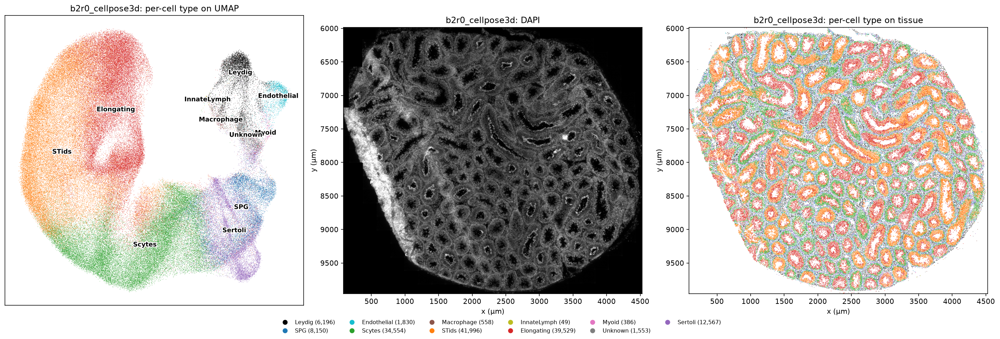

    cell_type
    STids          41996
    Elongating     39529
    Scytes         34554
    Sertoli        12567
    SPG             8150
    Leydig          6196
    Endothelial     1830
    Unknown         1553
    Macrophage       558
    Myoid            386
    InnateLymph       49

The same calls, collapsed to germ and somatic. Somatic cells are drawn
on top, since they are the smaller group and would otherwise be buried.

<details>
<summary>Code</summary>

``` python
plot_calls(umap, tissue_xy, adata.obs["germ_somatic"].astype(str), GROUP_COLORS, SAMPLE,
           "germ vs somatic", last=["somatic"], image=TISSUE_IMAGE)
plt.show()
share = adata.obs["germ_somatic"].value_counts(normalize=True)
print(f"germ {share['germ']:.1%}, somatic {share['somatic']:.1%}")
```

</details>

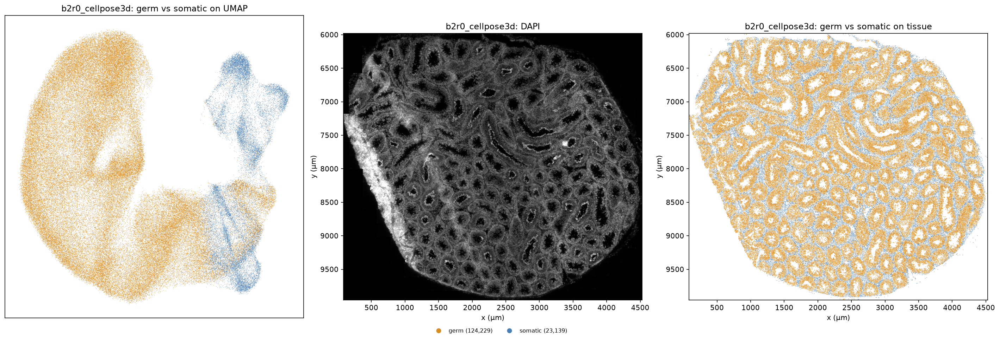

    germ 84.3%, somatic 15.7%

## D6. Germ-cell subtypes

The germ cells alone, against Green’s twelve germ-cell types, GC1 to
GC12, as published. The steps are D3 to D5 again on a finer reference:
Spearman correlation of each germ cell’s raw counts, standardized within
the cell, then its top type. Nothing is reclustered. GC1 to GC12 are
differentiation states in order, so on tissue they should run from the
wall inward.

<details>
<summary>Code</summary>

``` python
gc_file = REFERENCE_DIR / "green_gc.csv"
if not gc_file.exists():
    raise FileNotFoundError(f"{gc_file} is missing; the reference is an input and is not built here")

gc_reference = pd.read_csv(gc_file, index_col=0)[GC_TYPES]
gc_shared = [gene for gene in adata.var_names if gene in gc_reference.index]
gc_idx = adata.var_names.get_indexer(gc_shared)

is_germ = (adata.obs["germ_somatic"] == "germ").to_numpy()
germ_counts = np.asarray(adata.layers["counts"])[is_germ][:, gc_idx].astype(np.float32)
gc_corr = spearman_to_reference(germ_counts, gc_reference.loc[gc_shared])
gc_std = (gc_corr - gc_corr.mean(axis=1, keepdims=True)) / gc_corr.std(axis=1, keepdims=True)

adata.obs["germ_type"] = pd.Categorical([None] * adata.n_obs, categories=GC_TYPES)
adata.obs.loc[is_germ, "germ_type"] = np.array(GC_TYPES)[gc_std.argmax(axis=1)]
for j, gc in enumerate(GC_TYPES):
    adata.obs[f"corr_{gc}"] = np.nan
    adata.obs.loc[is_germ, f"corr_{gc}"] = gc_std[:, j]

gc_calls = adata.obs["germ_type"].astype(str).where(is_germ, "not germ")

# Each type is named where its cells sit on the UMAP, at the median of their positions.
gc_centres = {gc: np.median(umap[(gc_calls == gc).to_numpy()], axis=0) for gc in GC_TYPES}
plot_calls(umap, tissue_xy, gc_calls, GC_COLORS, SAMPLE, "germ-cell type", last=GC_TYPES, image=TISSUE_IMAGE,
           legend_cols=7, umap_labels=gc_centres)
plt.show()
print(f"{len(gc_shared)} of {adata.n_vars} panel genes shared with GC1-12")
print(adata.obs["germ_type"].value_counts().sort_index().to_string())
```

</details>

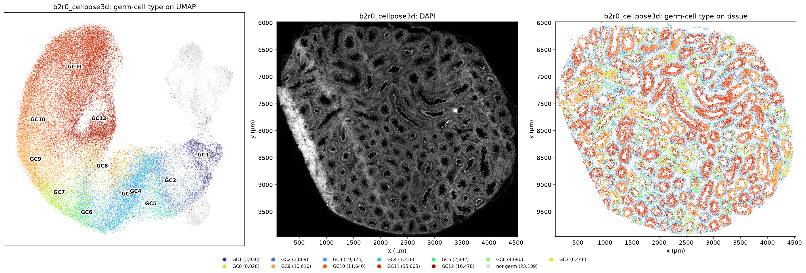

    488 of 491 panel genes shared with GC1-12
    germ_type
    GC1      3936
    GC2      3869
    GC3     19325
    GC4      1238
    GC5      2892
    GC6      4690
    GC7      6446
    GC8      8028
    GC9     10616
    GC10    11646
    GC11    35065
    GC12    16478

# Phase E — Tubules

Alex Vargo’s tubules, drawn over the same image and calls. His outlines
were traced from the Cellbound3 and DAPI images, not from cells, and
each tubule carries his flags: whether the cells assigned to it can be
trusted, and whether its outline is round enough for a radial profile.
This notebook reads the outlines and the flags and does not redo the
segmentation or assign cells.

## E1. Load the outlines

One `<id>.npz` per tubule, holding the outline as an integer path of
`(row, column)` points in mosaic pixels. The mosaic is the image’s own
frame, so the outlines need no shift: the columns are swapped to
`(x, y)` and the store’s pixel-to-micrometre transform, inverted in B2,
puts them on the same axes as the cells. Each tubule is then given one
of four flags from his table.

<details>
<summary>Code</summary>

``` python
to_um = [px_to_um[0, 0], px_to_um[0, 1], px_to_um[1, 0], px_to_um[1, 1], px_to_um[0, 2], px_to_um[1, 2]]
tubules_um = {
    path.stem: affine_transform(Polygon(np.load(path)["global_path"][:, ::-1]), to_um)
    for path in sorted(TUBULE_BOUNDS.glob("*.npz"), key=lambda p: int(p.stem))
}

tubule_meta = pd.read_csv(TUBULE_META, index_col=0)
tubule_meta.index = tubule_meta.index.astype(str)


def tubule_flag(tubule_id):
    if tubule_id not in tubule_meta.index:
        return "no metadata"
    row = tubule_meta.loc[tubule_id]
    if row["good_circle"]:
        return "good circle"
    return "good cells, not circular" if row["good_cells_bin"] else "not good cells"


flags = pd.Series({tubule_id: tubule_flag(tubule_id) for tubule_id in tubules_um})
flag_counts = flags.value_counts().reindex(TUBULE_FLAGS, fill_value=0)

print(f"{len(tubules_um)} tubules, {len(tubule_meta)} with a row in his table")
print(flag_counts.to_string())
```

</details>

    143 tubules, 142 with a row in his table
    good circle                 77
    good cells, not circular    57
    not good cells               8
    no metadata                  1

## E2. The tubules on the section

Left, the outlines on DAPI, coloured by flag. Middle and right, the same
outlines in navy over the per-cell type and the germ-cell type, with a
white halo so they stay visible over cells of any colour. All three
panels cover the same window.

<details>
<summary>Code</summary>

``` python
major_points = np.array([TYPE_COLORS[k] for k in major_calls])
gc_points = np.array([GC_COLORS[k] for k in gc_calls])
gc_order = np.argsort(gc_calls.to_numpy() != "not germ", kind="stable")    # germ cells are drawn on top

plot_tubule_overview(
    TISSUE_IMAGE, tubules_um, {i: TUBULE_FLAGS[f] for i, f in flags.items()}, flag_counts, tissue_xy,
    major_points, gc_points, gc_order, set(major_calls), set(gc_calls), SAMPLE,
)
plt.show()
```

</details>

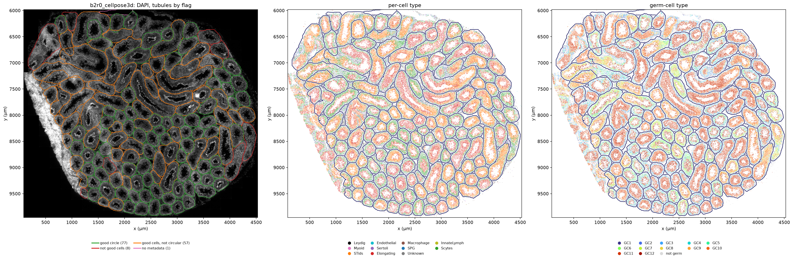

## E3. Tubules at full resolution

One tubule per flag, so each kind of outline is seen against the tissue:
for each flag, the tubule whose outline area is the median of that flag,
and for the tubules without a table row, the first. A crop is read from
the finest level of the image, a few tens of megabytes per channel, and
the cells in it are filled by type. His outline is drawn in its flag
colour on every panel.

<details>
<summary>Code</summary>

``` python
full = pyramid[levels[0]]["image"]
cell_shapes = sdata.shapes[cells_name]
cell_centres = cell_shapes.geometry.centroid
area = tubule_meta["area"]


def pick_tubule(flag):
    ids = flags.index[flags == flag]
    if flag == "no metadata":
        return ids[0]
    return area.loc[ids].sort_values().index[len(ids) // 2]


def read_crop(tubule_id, pad=30):
    """The tubule's bounding box, padded by `pad` µm, read from the finest image level."""
    x0, y0, x1, y1 = tubules_um[tubule_id].bounds
    corners = um_to_px @ np.array([[x0 - pad, x1 + pad], [y0 - pad, y1 + pad], [1, 1]])
    px0, px1 = int(max(corners[0].min(), 0)), int(min(corners[0].max(), full.shape[2]))
    py0, py1 = int(max(corners[1].min(), 0)), int(min(corners[1].max(), full.shape[1]))
    (ex0, ex1), (ey0, ey1) = (px_to_um @ np.array([[px0, px1], [py0, py1], [1, 1]]))[:2]
    channels = {c: full.sel(c=c).isel(y=slice(py0, py1), x=slice(px0, px1)).data.compute() for c in ["DAPI", "Cellbound3"]}
    return channels, (ex0, ex1, ey1, ey0)


def show_tubule(tubule_id, outline_color, label):
    """Draw one tubule at full resolution, with its cells filled by type."""
    channels, extent = read_crop(tubule_id)

    # The cells whose centres are in view and that survived the filter in C1.
    in_view = ((cell_centres.x > extent[0]) & (cell_centres.x < extent[1])
               & (cell_centres.y > extent[3]) & (cell_centres.y < extent[2])).to_numpy()
    in_table = cell_shapes.index[in_view].astype(str).isin(adata.obs_names)
    ids = cell_shapes.index[in_view][in_table].astype(str)
    parts = [(np.asarray(part.exterior.coords), cell_id)
             for geometry, cell_id in zip(cell_shapes.geometry[in_view][in_table], ids) for part in geometry.geoms]
    cell_polygons = [coords for coords, _ in parts]
    major_here = [major_calls[cell_id] for _, cell_id in parts]
    gc_here = [gc_calls[cell_id] for _, cell_id in parts]

    plot_tubule_crop(
        channels, extent, tubules_um[tubule_id], outline_color, cell_polygons,
        [TYPE_COLORS[k] for k in major_here], [GC_COLORS[k] for k in gc_here], set(major_here), set(gc_here),
        f"Tubule {tubule_id}: {label}   ({len(ids):,} cells from the table in view)",
    )
    plt.show()
    print(f"tubule {tubule_id}, {label}: {channels['DAPI'].shape[1]} x {channels['DAPI'].shape[0]} px, "
          f"{channels['DAPI'].nbytes / 1e6:.0f} MB per channel")


for flag in TUBULE_FLAGS:
    if flag_counts[flag]:
        show_tubule(pick_tubule(flag), TUBULE_FLAGS[flag], flag)
```

</details>

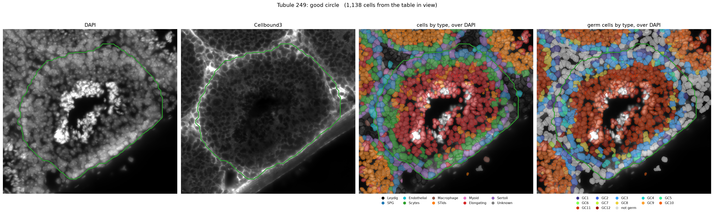

    tubule 249, good circle: 3283 x 3110 px, 20 MB per channel

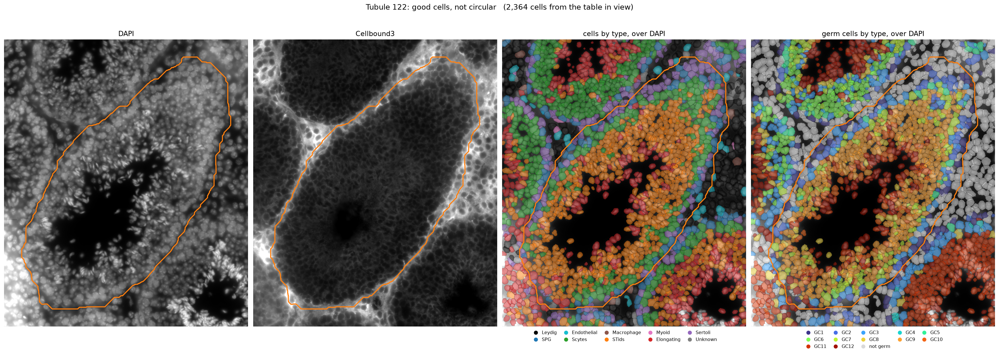

    tubule 122, good cells, not circular: 3870 x 4548 px, 35 MB per channel

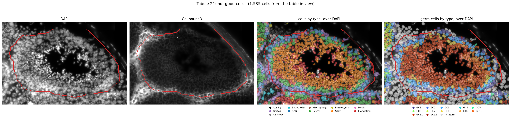

    tubule 21, not good cells: 4755 x 3166 px, 30 MB per channel

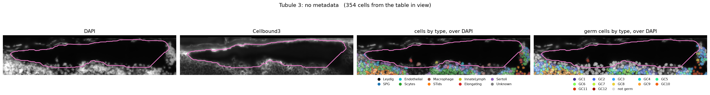

    tubule 3, no metadata: 6525 x 1504 px, 20 MB per channel

## E4. Which tubule each cell is in

His map has one entry per cell of the section’s table, in the table’s
order: a tubule id, or none for a cell outside every tubule. C1 dropped
cells, so each cell’s position in the full table, kept in B1 as
`table_row`, picks out its entry. It is his assignment, by his rule for
cells on a boundary, and is not recomputed from the outlines in E1.

<details>
<summary>Code</summary>

``` python
cell_map = np.load(TUBULE_MAP, allow_pickle=True)["cell_map"]
assert len(cell_map) == N_TABLE_CELLS, "the map is not indexed by this section's table"

assigned = cell_map[adata.obs["table_row"].to_numpy()]
adata.obs["tubule_id"] = np.array(["" if t is None else str(t) for t in assigned], dtype=object)

in_tubule = adata.obs["tubule_id"] != ""
print(f"{in_tubule.sum():,} of {adata.n_obs:,} cells are in a tubule ({in_tubule.mean():.0%}); "
      f"{adata.obs.loc[in_tubule, 'tubule_id'].nunique()} tubules")
```

</details>

    131,377 of 147,368 cells are in a tubule (89%); 143 tubules

# Phase G — Tubule stage

Each tubule cross-section sits at one point of the cycle of the
seminiferous epithelium. The stage used here is Alex Vargo’s
computational one: each tubule’s radial gene profile is placed on a ring
by a principal component analysis across all sixteen sections, and the
ring is cut into four stage groups, 1 to 4. It is made only for the
tubules he flagged as good circles, so the others have no stage. His
cutoffs were fit to his stage calls made by eye, which agree with these
to within one group.

## G1. The stage of each tubule

His table covers every section, so the section’s rows are picked by the
name his files carry, the part of the metadata file’s name before
`-tubule-metadata`.

<details>
<summary>Code</summary>

``` python
section = TUBULE_META.name.split("-tubule-metadata")[0]
stage_table = pd.read_csv(TUBULE_ORDER)
stage_table = stage_table[stage_table["samp"] == section]
assert len(stage_table), f"{TUBULE_ORDER.name} has no rows for {section}"

stage_table["tube_id"] = stage_table["tube_id"].astype(int).astype(str)
stage_of = stage_table.set_index("tube_id")["prop_stage"].astype(int)
assert set(stage_of.index) <= set(tubules_um), "a staged tubule has no outline"

stage_counts = stage_of.value_counts().reindex(STAGES, fill_value=0)
print(f"{section}: {len(stage_of)} of {len(tubules_um)} tubules are staged")
print(stage_counts.rename(lambda s: f"stage {s}").to_string())
```

</details>

    b2r0: 77 of 143 tubules are staged
    prop_stage
    stage 1    17
    stage 2    28
    stage 3    11
    stage 4    21

## G2. The tubules by stage

The staged tubules are drawn thick in their stage’s colour and the
others thin and grey, on DAPI and over the germ-cell type calls. Tubules
at one stage tend to lie together, which is the order of the section and
not something the stage was built from.

<details>
<summary>Code</summary>

``` python
plot_stage_outlines(
    TISSUE_IMAGE, tubules_um, {i: STAGE_COLORS[s] for i, s in stage_of.items()}, set(stage_of.index),
    tissue_xy, gc_points, gc_order, stage_counts, len(tubules_um) - len(stage_of), SAMPLE,
)
plt.show()
```

</details>

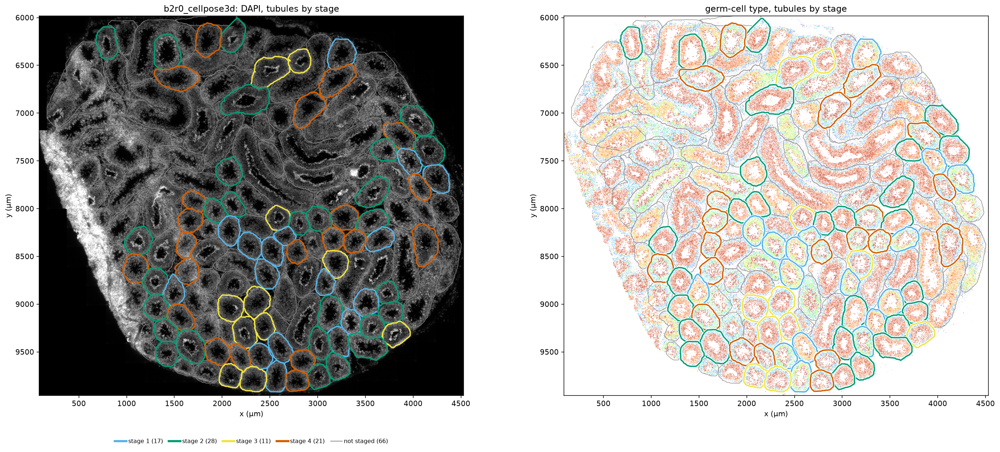

## G3. Stage on the UMAP and the tissue

Each cell takes the stage of the tubule it is in. Cells in a tubule with
no stage, and cells outside every tubule, are grey and drawn first, so
the staged cells are on top. The UMAP shows whether the stages occupy
different parts of the germ-cell arc. This is not independent of the
calls: the stage was computed from gene profiles of these same cells.

<details>
<summary>Code</summary>

``` python
def stage_label(tubule_id):
    if tubule_id == "":
        return "outside tubules"
    return f"stage {stage_of[tubule_id]}" if tubule_id in stage_of.index else "unstaged tubule"


stage_calls = adata.obs["tubule_id"].map(stage_label)

plot_calls(umap, tissue_xy, stage_calls, STAGE_CELL_COLORS, SAMPLE, "tubule stage",
           last=[f"stage {s}" for s in STAGES], image=TISSUE_IMAGE, legend_cols=6)
plt.show()
print(stage_calls.value_counts().reindex(STAGE_CELL_COLORS).to_string())
```

</details>

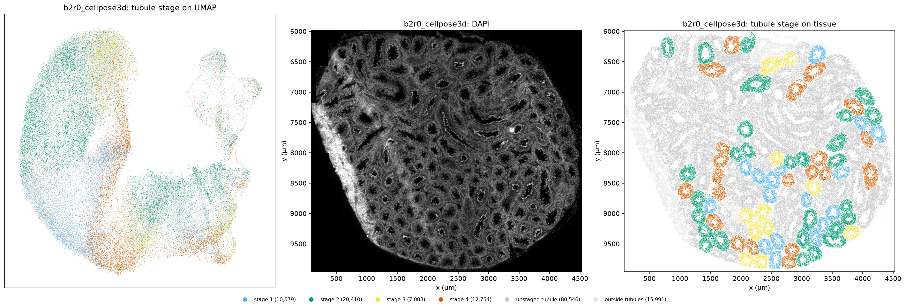

    tubule_id
    stage 1            10579
    stage 2            20410
    stage 3             7088
    stage 4            12754
    unstaged tubule    80546
    outside tubules    15991

# Phase H — Composition by stage

## H1. Cell types in a tubule, by stage

For each staged tubule, the share of its cells that are each type, and
of its germ cells that are each germ-cell type. The bars are the mean
across the tubules at a stage. A Kruskal-Wallis test per type asks
whether its share differs between the four stages; the p values are not
corrected for the number of types, and neighbouring tubules are not
independent, so they say how large a difference is and not how certain
it is. Types between the tubules (Leydig, Endothelial, Macrophage,
InnateLymph, Myoid) should not change with stage: they are cells inside
generous outlines and not residents of the tubule.

<details>
<summary>Code</summary>

``` python
staged_cells = adata.obs.loc[adata.obs["tubule_id"].isin(stage_of.index), ["tubule_id"]].assign(
    cell_type=major_calls, germ_type=gc_calls)


def composition(column, names, cells):
    """Share of each tubule's cells that are each of `names`, one row per tubule."""
    counts = pd.crosstab(cells["tubule_id"], cells[column]).reindex(columns=names, fill_value=0)
    counts = counts[counts.sum(axis=1) > 0]
    return counts.div(counts.sum(axis=1), axis=0)


def by_stage(shares):
    return shares.groupby(stage_of.reindex(shares.index)).mean()


def kruskal_p(shares, name):
    groups = [shares.loc[stage_of.reindex(shares.index) == s, name] for s in STAGES]
    return kruskal(*groups).pvalue


type_shares = composition("cell_type", list(TYPE_COLORS), staged_cells)
gc_shares = composition("germ_type", GC_TYPES, staged_cells[staged_cells["germ_type"] != "not germ"])
mean_types, mean_gc = by_stage(type_shares), by_stage(gc_shares)

for label, mean, shares in [("cell type, % of a tubule's cells", mean_types, type_shares),
                            ("germ-cell type, % of a tubule's germ cells", mean_gc, gc_shares)]:
    table = (mean.T * 100).round(1).rename(columns=lambda s: f"stage {s}")
    table["Kruskal p"] = [f"{kruskal_p(shares, name):.1e}" for name in mean.columns]
    print(label)
    print(table.to_string(), end="\n\n")

plot_stage_composition(mean_types, mean_gc, stage_counts, SAMPLE)
plt.show()
```

</details>

    cell type, % of a tubule's cells
    prop_stage   stage 1  stage 2  stage 3  stage 4 Kruskal p
    cell_type                                                
    Leydig           1.5      2.0      1.6      1.7   3.1e-01
    Endothelial      0.5      0.7      0.7      0.7   2.6e-01
    Macrophage       0.2      0.2      0.2      0.2   9.7e-01
    InnateLymph      0.0      0.0      0.0      0.0   4.5e-01
    Myoid            0.2      0.1      0.2      0.2   5.0e-01
    Sertoli          9.8      7.4      9.7     11.7   9.2e-08
    SPG              4.7      6.2      6.2      6.0   5.2e-03
    Scytes          38.5     13.4     22.9     40.1   3.5e-11
    STids           25.5     48.2      6.0      4.9   2.3e-11
    Elongating      18.3     21.0     51.4     33.4   3.6e-09
    Unknown          0.8      0.8      0.9      0.9   4.8e-01

    germ-cell type, % of a tubule's germ cells
    prop_stage  stage 1  stage 2  stage 3  stage 4 Kruskal p
    germ_type                                               
    GC1             2.0      4.0      3.1      2.2   1.3e-06
    GC2             4.0      2.8      2.7      3.6   2.8e-02
    GC3            12.9     12.2     21.3     27.2   9.2e-11
    GC4             0.2      1.1      2.6      0.6   3.3e-09
    GC5             3.0      1.0      2.7      5.6   3.2e-10
    GC6             9.3      0.1      1.3     14.3   2.4e-10
    GC7            18.7      0.4      0.0      0.7   2.2e-10
    GC8             7.9      3.7      5.5     10.1   1.1e-07
    GC9            16.9      5.3      0.0      0.1   8.9e-08
    GC10            4.2     22.5      0.0      0.4   6.2e-09
    GC11            4.5     40.3     41.4      8.9   3.3e-11
    GC12           16.5      6.6     19.4     26.3   1.0e-11

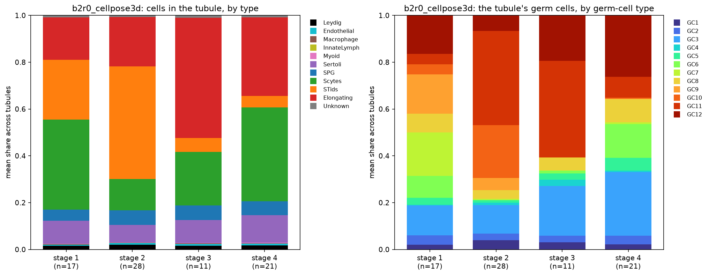

## H2. One tubule per stage at full resolution

The composition above is a mean, so here is a single tubule at each
stage. It is the staged tubule whose germ-cell type shares are closest
to the stage’s mean, by the sum of the absolute differences, so each is
a typical tubule of its stage and not a clear one or an odd one. They
illustrate the means and do not test them. Each panel set is the same as
in E3, with the outline in the stage’s colour.

<details>
<summary>Code</summary>

``` python
for stage in STAGES:
    candidates = stage_of.index[stage_of == stage].intersection(gc_shares.index)
    distance = (gc_shares.loc[candidates] - mean_gc.loc[stage]).abs().sum(axis=1)
    print(f"stage {stage}: tubule {distance.idxmin()}, distance to the stage mean {distance.min():.2f} "
          f"(median over its tubules {distance.median():.2f})")
    show_tubule(distance.idxmin(), STAGE_COLORS[stage], f"stage {stage}")
```

</details>

    stage 1: tubule 15, distance to the stage mean 0.30 (median over its tubules 0.56)

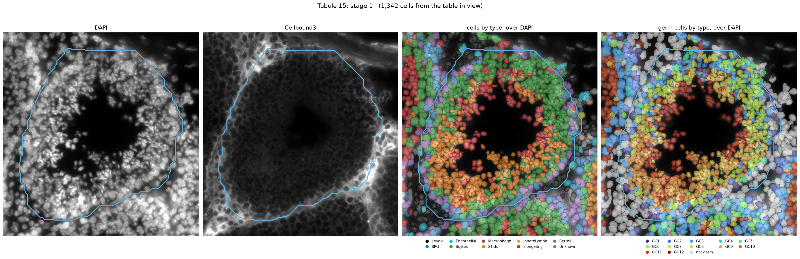

    tubule 15, stage 1: 3364 x 3519 px, 24 MB per channel
    stage 2: tubule 270, distance to the stage mean 0.14 (median over its tubules 0.60)

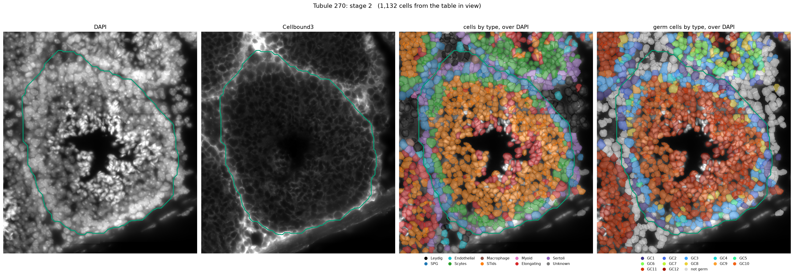

    tubule 270, stage 2: 2854 x 3275 px, 19 MB per channel
    stage 3: tubule 227, distance to the stage mean 0.13 (median over its tubules 0.24)

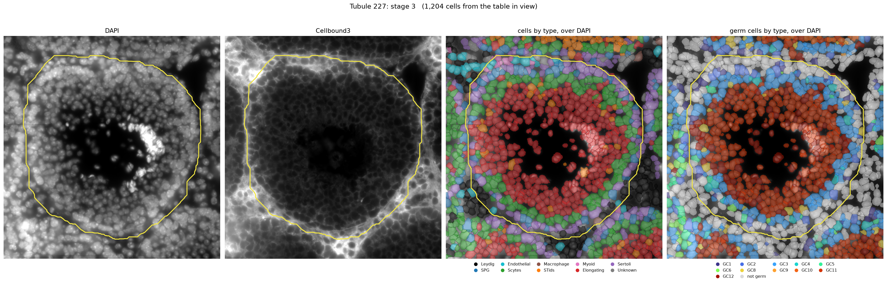

    tubule 227, stage 3: 3060 x 3154 px, 19 MB per channel
    stage 4: tubule 26, distance to the stage mean 0.11 (median over its tubules 0.26)

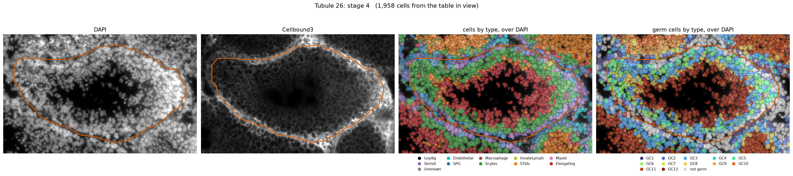

    tubule 26, stage 4: 4914 x 3024 px, 30 MB per channel
